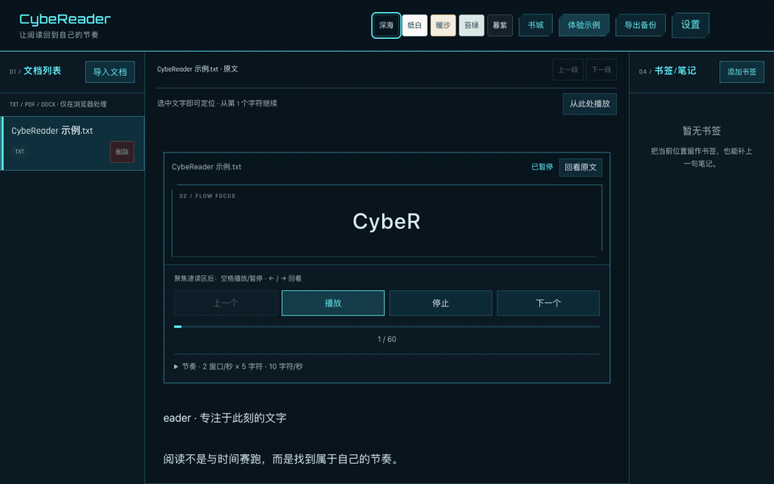
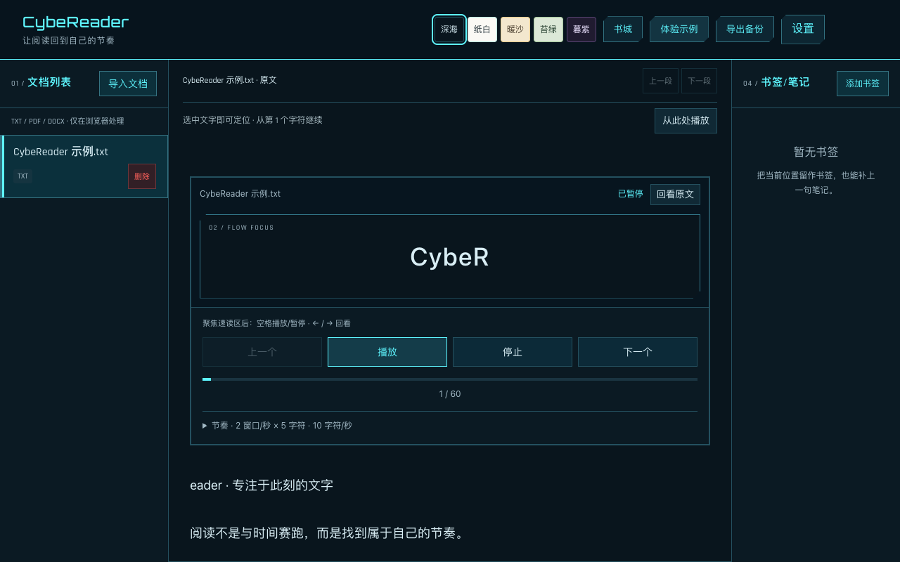
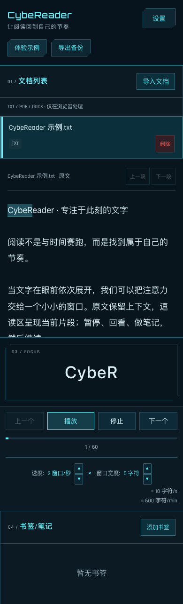

# CybeReader

**让阅读回到自己的节奏。** 采用 2077 协议风格的纯浏览器双窗口速读工具：保留原文上下文，同时以可调宽度、速度展示文字片段。适合专注练习与回看，不承诺提高理解力或提供经验证的训练效果。



演示为真实浏览器操作：加载原创示例 → 播放 → 调整窗口与速度 → 暂停、书签与笔记 → 设置 → 跳转后继续。未使用私人书籍、合成 UI 或虚构数据。



<details><summary>查看手机布局</summary>



</details>

## 功能

- TXT、文字型 PDF、DOCX 正文提取；全部在当前浏览器内处理，不上传文档。
- 原文可选字定位（正向/反向选择、长文分段、Unicode 字素保护），选择会暂停；“从此处播放”从选中起点继续，书签和进度保留精确位置。
- 顶部右侧统一排列五种阅读配色、书城、示例、备份和设置；配色持久保存，不覆盖自定义颜色。
- 书城提供 Project Gutenberg 的《老子》《论语》《三国演义》固定文本快照，按需一键导入，附来源与下载；不上传私人文档、不依赖运行时跨域抓取。
- 原文高亮与速读片段同步；播放、暂停、停止、前后片段与完成自动暂停。
- 1–20 字符窗口、0.5–20 窗口/秒；采用 Unicode 字素分组，中文、组合字符和 emoji 不拆碎。
- 切换窗口宽度时保留绝对文字位置；书签、笔记和阅读进度保存在当前浏览器。
- 长文按约 8,000 字符分段显示原文，不在每个播放节拍重绘整本书；“上一段 / 下一段”可翻阅。
- 手机布局、键盘操作、可调整颜色与字号；内置原创示例，无需准备文件即可体验。
- JSON 备份导出，包含文档文本、书签、设置与进度。备份可能包含私人内容，请妥善保存；当前未提供一键导入备份功能。

## 启动

需要 **Node.js 22.12+（推荐 24）**。应用不需要后端、账号、API Key 或 Python。

```bash
git clone https://github.com/CyberFork/CybeReader.git
cd CybeReader
npm ci --ignore-scripts
npm run dev -- --host 127.0.0.1
```

点击“体验示例”或“导入文档”。生产构建与预览：

```bash
npm run build
npm run preview -- --host 127.0.0.1 --port 4175
```

`dist/` 可部署到静态服务器。线上入口：**https://work.cyberforker.com/cybereader/**。以 `/cybereader/` 为固定资源基路径；直接访问该路径即可载入阅读器。

## 操作

- 单击文档，或聚焦文档条目后按 Enter / Space。
- 聚焦“速读控制区”后：Space 播放/暂停；← / → 切换片段。
- 在原文中拖选文字（手机长按选字、键盘选字），定位到所选内容开头；点击“从此处播放”或速读区“播放”继续。
- “停止”返回文档开头；“跳转”回到书签。
- 设置面板支持 Tab 焦点循环、Escape 关闭并返回触发按钮。
- 页面进入后台时自动暂停，避免离开后跳过文字。

## 格式与存储边界

- `.doc` 不支持，请先另存为 `.docx` 或 `.txt`。扫描 PDF 需要先 OCR；加密、损坏或无文本文件会显示错误。
- DOCX 仅提取正文段落文字，不保留复杂排版、图片、批注、脚注与编号样式。
- 单文件上限 20 MB、提取文本上限 100 万字符、DOCX 正文解压上限 5 MB；浏览器存储配额可能更低。配额不足时导入不会伪装成保存成功。
- 数据保存在该浏览器、该站点的 localStorage 中，不跨设备同步；清理网站数据会删除阅读资料。私人模式或禁用存储可能影响持久化。
- PDF Worker 随构建本地提供，不依赖 CDN。PDF 与 ZIP 解析代码按需加载，普通 TXT 阅读无需下载这些模块。
- 不要导入来源不可信的文档；文件限制与依赖扫描不是对所有恶意输入的安全保证。
- `books/` 是本机私人文档目录，明确排除 Git；依赖、构建物、缓存、凭据和 macOS 元数据也不提交。

## 测试与可重录演示

```bash
npm test
npm run build
npx playwright install chromium
# 保持另一个终端的 preview 运行
npm run test:browser
node tests/selection-library-browser.mjs
npm run demo:record
```

也可以用 `CHROMIUM_EXECUTABLE` 指定已安装的 Chrome。默认测试 / 录制地址为 `http://127.0.0.1:4175/cybereader/`，可用 `APP_URL` 覆盖。GIF 录制需要 ffmpeg；帧文件只写到系统临时目录。

自动化覆盖：字素/字符偏移、非法参数、导入边界、播放/暂停/完成、前后移动、书签笔记、进度恢复、PDF/DOCX 本地解析、旧 DOC 错误、长文 DOM 预算、键盘焦点、备份导出和手机无横向溢出。`.github/workflows/ci.yml` 在推送与 PR 时运行构建和测试。

测试用 PDF / DOCX 均为新生成的微型原创夹具，可通过 `python3 scripts/create-fixtures.py` 重建；应用运行本身不依赖 Python。

## 技术与参考

React 18 + TypeScript + Vite；[PDF.js](https://mozilla.github.io/pdf.js/)；[fflate](https://github.com/101arrowz/fflate) + 浏览器 XML 解析器。文档只以 React 纯文本呈现，不注入 HTML。

升级了受 [CVE-2024-4367](https://github.com/mozilla/pdf.js/security/advisories/GHSA-wgrm-67xf-hhpq) 影响的旧版 PDF.js。移除 Mammoth 及其旧解析依赖，DOCX 使用限定条目的 ZIP 提取。依赖安全扫描结果仅代表执行时的已知问题，不等于永久安全。

## 许可证

项目源码已公开，**项目许可证尚待作者确认**，暂不宣称 MIT 或其他授权。第三方依赖仍按其各自许可使用，见 [第三方声明](THIRD_PARTY_NOTICES.md)。

## 部署

`deploy/Dockerfile` 打包已验证的 `dist`，由非 root Nginx 提供 `/cybereader/`。`/cybereader` 会保留查询参数跳转到带斜杠路径；其他路径返回 404，不占用 work 域名的其他应用路由。

更名保留原 `speed_reader_*` 浏览器存储键，避免同源升级丢失旧阅读资料。不同域名/本机端口之间遵循浏览器同源隔离，不会自动同步私人文档。

## 2077 视觉来源

配色与几何语法参考作者指定的 CyberAnchor `design/skins/2077`，使用青色协议强调、暗色面板、细边框与切角，自行编写 CSS；没有复制 APK、游戏图像或锁定布局。Rajdhani / Orbitron 随包附 OFL 许可。阅读背景/文字/高亮仍可自定义，已保存的配色不会因主题更新被覆盖。界面无持续动画或 WebGL。

生产部署使用 Hecate 的既有 `work-sync-gateway`，只增加 `deploy/work-gateway-snippet.conf` 中的两个 `/cybereader` 路由。CybeReader 为独立只读容器，加入已有 `work-sync_default` 网络；不用修改 DNS 或 Tunnel，也不改变 SFTPGo、MSV、Zen、SudokuPon 等兄弟应用。网关上线前必须备份配置、检查源哈希、执行 `nginx -t`，通过后仅热重载。
